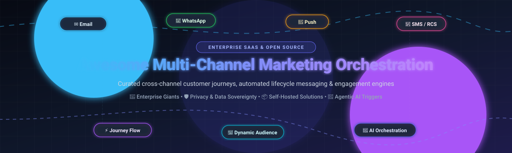
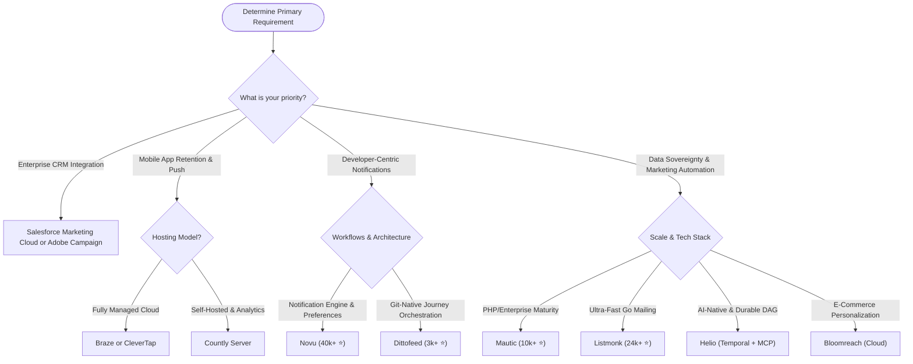

# 🚀 Awesome Multi-Channel Marketing Orchestration

  

  
  
  
  
  
  
  

> 🌟 **A definitive, SEO-curated index of top Multi-Channel Marketing Orchestration (MMH) platforms** — comparing enterprise SaaS leaders and cutting-edge open-source customer journey automation engines across Email, SMS, Web/Mobile Push, WhatsApp, RCS, In-App messaging, and Agentic AI workflows.
>
> ⭐ **Star this repository if you find it valuable for your engineering, growth, or marketing tech stack!** ⭐

---

## 📑 Table of Contents

- [🌐 Sector Overview & Market Dynamics](#-sector-overview--market-dynamics)
- [🏢 SaaS & Hosted Commercial Platforms](#-saas--hosted-commercial-platforms)
  - [📊 Commercial Platforms Comparison](#-commercial-platforms-comparison)
  - [🔍 Deep-Dive: Commercial Solutions](#-deep-dive-commercial-solutions)
- [💻 Open-Source Customer Engagement Platforms](#-open-source-customer-engagement-platforms)
  - [⭐ Open-Source Leaderboard (Ranked by Stars)](#-open-source-leaderboard-ranked-by-stars)
  - [🔍 Deep-Dive: Open-Source Solutions](#-deep-dive-open-source-solutions)
- [🥊 Feature & Architecture Matrix](#-feature--architecture-matrix)
- [💡 Selection Guide: Choosing the Right Engine](#-selection-guide-choosing-the-right-engine)
- [💖 Support & Sponsorship](#-support--sponsorship)
- [⭐ Star History](#-star-history)
- [🤝 Contributing](#-contributing)
- [📄 License](#-license)

---

## 🌐 Sector Overview & Market Dynamics

The global **Multichannel Marketing Hubs (MMH)** market is valued at approximately **$6.39 billion** and is projected to expand to **$10.13 billion by 2030** (~9.2% CAGR) and over **$13.55 billion by 2035**.

The sector exhibits **moderate fragmentation with an enterprise core**: while mega-cap legacy suites (Salesforce, Adobe) dominate Fortune 500 ecosystems through bundled CRM integrations, the landscape remains highly competitive and fragmented due to rapid channel expansion (RCS, WhatsApp, conversational interfaces) and the rise of agile, composable customer engagement platforms (Braze, Iterable, Bloomreach) alongside developer-centric, privacy-first open-source architectures.

---

## 🏢 SaaS & Hosted Commercial Platforms

Commercial, cloud-hosted Multi-Channel Marketing Orchestration platforms engineered for high-throughput messaging, AI-guided customer journeys, and enterprise compliance.

### 📊 Commercial Platforms Comparison

*The table below is sorted in **descending order by company valuation / market capitalization**.*

| 🏢 Platform | 💰 Company Valuation / Revenue | 🏷️ Starting Tier Pricing | 🎁 Free Tier / Trial Limit | 🎯 Key Channels & Focus |
|:---|:---|:---|:---|:---|
| **[Salesforce Marketing Cloud](https://www.salesforce.com/products/marketing-cloud/)** | **~$290 Billion** Market Cap (Salesforce Inc. ARR >$35B) | **$1,250/month** (Account Engagement+, billed annually) / Starter at $25/user/mo | **No Free Tier**; Custom demo / 30-day trial upon enterprise sales request (via Sales/Service Cloud) | Enterprise CRM ecosystem, Einstein AI, Omni-channel Journeys |
| **[Adobe Campaign](https://business.adobe.com/products/campaign/adobe-campaign.html)** | **~$220 Billion** Market Cap (Adobe Experience Cloud >$5B ARR) | **$6,667/month** (~$80,000/year billed annually; scales to $250k–$800k+) | **No Free Tier**; 0-day public trial (Strictly sales-guided POC demo only) | Enterprise cross-channel campaign management, offline & direct mail |
| **[Braze](https://www.braze.com/)** | **~$5.66 Billion** Valuation ($593.4M FY25 Revenue, ARR >$650M) | **$4,167/month** (~$50,000/year base platform agreement, billed annually) | **14-day Free Trial** (Guided product tours, pre-built templates, capped MAU) | Mobile-first engagement, Push, In-App, BrazeAI™ journey logic |
| **[Bloomreach](https://www.bloomreach.com/)** | **$2.2 Billion** Valuation (ARR >$260 Million) | **$5,000/month** (~$60,000/year starting scope, billed annually) | **No Free Tier**; 0-day public trial (Enterprise demo & tailored POC only) | E-commerce personalization, Loomi AI, customer data platform |
| **[Iterable](https://iterable.com/)** | **$2.0 Billion** Valuation (ARR >$200 Million) | **$4,167/month** (~$50,000/year mid-market baseline, billed annually) | **No Free Tier**; 0-day public trial (Scored enterprise POC via sales) | Growth & enterprise cross-channel automation, Nova AI intelligence |
| **[Zoho Marketing Plus](https://www.zoho.com/marketingplus/)** | **$1.0+ Billion** ARR (Zoho Corp. valuation ~$8B–$10B bootstrapped) | **$25/user/month** (Billed annually; flat transparent SMB tier) | **15-day Free Trial** (Full access, no credit card required) | SMB unified marketing suite, integrated campaigns, social & email |
| **[CleverTap](https://clevertap.com/)** | **~$750 Million** Valuation (Annual revenue ~$80M–$120M) | **$75/month** (Essentials plan, up to 5,000 MAUs) | **30-day Free Trial** (Capped at 5,000 MAUs, full platform features) | Consumer mobile apps, behavioral analytics, push, retention |
| **[MoEngage](https://www.moengage.com/)** | **$700 Million** Valuation (Scaling B2C mid-market & enterprise) | **$1,250/month** (Growth tier minimum commitment; avg contract ~$185k/yr) | **No Free Tier**; 0-day public trial (Custom sales-guided POC environment) | Insights-led customer engagement, retail, fintech, media |

---

### 🔍 Deep-Dive: Commercial Solutions

#### 🔹 [Salesforce Marketing Cloud](https://www.salesforce.com/products/marketing-cloud/)
* **Category:** Enterprise Customer 360 Marketing Suite
* **Channels:** Email, Mobile SMS, Mobile App Push, WhatsApp, Social Studio, Advertising Audiences.
* **Architecture:** Tightly integrated with the Salesforce CRM ecosystem, Einstein 1 AI, and Data Cloud. Ideal for large enterprises needing governance, granular role-based permissions, and automated sales-marketing lifecycle handoffs.

#### 🔹 [Adobe Campaign](https://business.adobe.com/products/campaign/adobe-campaign.html)
* **Category:** Omnichannel Experience & Campaign Management
* **Channels:** Email, Push, SMS, In-App, Direct Mail, POS/In-Store Kiosks.
* **Architecture:** Integrates natively with Adobe Experience Platform (AEP), Real-Time CDP, and Adobe Journey Optimizer (AJO). Designed for global enterprises handling millions of transactional and promotional messages with strict brand governance.

#### 🔹 [Braze](https://www.braze.com/)
* **Category:** Real-Time Customer Engagement Platform (CEP)
* **Channels:** Push Notifications, In-App Messages, Content Cards, Email, SMS/MMS, WhatsApp, Webhooks.
* **Architecture:** Stream-based event processing architecture that triggers lifecycle communication within milliseconds of user actions. Positioned for high-growth consumer apps and digital-first organizations.

#### 🔹 [Bloomreach](https://www.bloomreach.com/)
* **Category:** Commerce Experience & Personalization Engine
* **Channels:** Email, SMS, Web Push, In-App, Dynamic On-Site Personalization.
* **Architecture:** Combines an e-commerce Customer Data Platform (CDP) with AI-powered search, merchandising, and automated journey flows (Loomi AI). Tailored for online retailers and DTC brands.

#### 🔹 [Iterable](https://iterable.com/)
* **Category:** AI-Powered Growth Marketing Automation
* **Channels:** Email, SMS/MMS, Mobile Push, Web Push, In-App, WhatsApp, Direct Mail webhooks.
* **Architecture:** Flexible data schema that ingests arbitrary JSON payload events without predefined column restrictions. Features Nova AI for predictive send-time optimization and channel affinity.

#### 🔹 [Zoho Marketing Plus](https://www.zoho.com/marketingplus/)
* **Category:** All-in-One Marketing Operations & Campaign Hub
* **Channels:** Email, SMS, Social Media, Landing Pages, Webinars.
* **Architecture:** An affordable, unified workspace aggregating Zoho Campaigns, Social, PageSense, and Backstage. Highly practical for small-to-midsize businesses (SMBs) seeking rapid deployment.

#### 🔹 [CleverTap](https://clevertap.com/)
* **Category:** Retention & Engagement Platform for Mobile Apps
* **Channels:** Mobile Push, In-App, App Inbox, WhatsApp, SMS, Web Push, Email.
* **Architecture:** Purpose-built for retention-focused mobile marketers, offering predictive churn scores, automated RFM segmentation, and real-time funnels.

#### 🔹 [MoEngage](https://www.moengage.com/)
* **Category:** Insights-Led Customer Engagement Platform
* **Channels:** Push, In-App, SMS, WhatsApp, Email, Web Personalization.
* **Architecture:** Employs Sherpa AI to predict customer behavior, recommend optimal journey paths, and auto-segment audiences across retail, e-commerce, and banking.

---

## 💻 Open-Source Customer Engagement Platforms

Self-hosted, transparent, and data-sovereign Multi-Channel Marketing Orchestration tools. These solutions allow organizations to own their customer data, bypass prohibitive per-contact fees, and execute automated multi-channel journeys.

### ⭐ Open-Source Leaderboard (Ranked by Stars)

*The table below is sorted in **descending order by GitHub stargazers count**.*

| 📦 Repository | ⭐ GitHub_Stars | 🛠️ Tech Stack | 📜 License | 📡 Supported Channels | 🚀 Visual Journey Builder |
|:---|:---|:---|:---|:---|:---|
| **[Novu](https://github.com/novuhq/novu)** |  | TypeScript, Node.js, Redis, MongoDB | MIT / Apache-2.0 | Email, SMS, Push, In-App, Chat (Slack/Discord) | ✅ Visual Workflow Engine |
| **[Listmonk](https://github.com/knadh/listmonk)** |  | Go, Vue.js, PostgreSQL | AGPL-3.0 | Email, SMS, Custom Messenger Webhooks | ❌ List & Campaign based |
| **[Mautic](https://github.com/mautic/mautic)** |  | PHP, Symfony, MySQL, Redis | GPL-3.0 | Email, SMS, Web Push, Social, In-App, Webhooks | ✅ Drag-and-Drop Canvas |
| **[Countly](https://github.com/Countly/countly-server)** |  | Node.js, MongoDB, JavaScript | AGPL-3.0 / Community | Push, In-App, Surveys, Rating Prompts | ✅ Journey & Funnel Builder |
| **[Dittofeed](https://github.com/dittofeed/dittofeed)** |  | TypeScript, Node.js, PostgreSQL, ClickHouse | MIT (Core) | Email, SMS, Mobile Push, WhatsApp, Slack | ✅ Node-based Flow Builder |
| **[Laudspeaker](https://github.com/laudspeaker/laudspeaker)** |  | TypeScript, Node.js, PostgreSQL | AGPL-3.0 | Email, SMS, Mobile Push, Slack, Webhooks | ✅ No-Code Step Builder |
| **[Keila](https://github.com/pentacent/keila)** |  | Elixir, Phoenix, PostgreSQL | AGPL-3.0 | Email (Privacy & GDPR focused) | ❌ Automated Triggers |
| **[SendPortal](https://github.com/mettle/sendportal)** |  | PHP, Laravel, MySQL/Postgres | MIT | Email (Multi-tenant ESP integration) | ❌ Broadcast & Segment Based |
| **[Parcelvoy](https://github.com/parcelvoy/platform)** |  | TypeScript, Node.js, React, Postgres | Apache-2.0 | Email, SMS, Mobile Push, Webhooks | ✅ Visual Journey Canvas |
| **[LimeJourney](https://github.com/LimeJourney/limeJourney)** |  | TypeScript, NestJS, Postgres | MIT | Email, SMS, Push, Webhooks | ✅ Customer.io Style Visuals |
| **[Helio](https://github.com/achref-soua/helio)** |  | TypeScript, Python, Temporal, ClickHouse | AGPL-3.0 | Web Push, SMS, WhatsApp, In-App, Email | ✅ React Flow + Temporal DAG |

---

### 🔍 Deep-Dive: Open-Source Solutions

#### 🥇 1. [Novu](https://github.com/novuhq/novu)
* **Overview:** The premier open-source communication infrastructure for development teams and autonomous AI agents. Novu centralizes multi-channel notifications and customer messaging with built-in digest engines, user preference centers, and conditional branching.
* **Tech Stack:** TypeScript, Node.js, Redis, MongoDB.
* **License:** MIT / Apache-2.0.
* **Why it stands out:** Offers an enterprise-grade notification center with turnkey SDKs (React, Vue, Flutter, iOS, Android), code-first step configurations, and high resilience.
* **Best for:** Engineering teams building user-facing and transactional multi-channel notifications into modern applications.

#### 🥈 2. [Listmonk](https://github.com/knadh/listmonk)
* **Overview:** An extremely fast, lightweight, self-hosted newsletter and mailing list manager packaged as a single binary executable.
* **Tech Stack:** Go, Vue.js, PostgreSQL.
* **License:** AGPL-3.0.
* **Why it stands out:** Capable of dispatching thousands of messages per second with minimal memory consumption. Includes multi-provider SMS and webhook pipelines.
* **Best for:** Developers needing blistering performance for high-volume subscriber communications on modest hardware.

#### 🥉 3. [Mautic](https://github.com/mautic/mautic)
* **Overview:** The pioneer and most established open-source marketing automation platform worldwide, providing full data ownership and enterprise GDPR compliance.
* **Tech Stack:** PHP, Symfony, MySQL, Redis.
* **License:** GPL-3.0.
* **Why it stands out:** Comprehensive CRM integrations, sophisticated lead scoring, visual campaign builder, dynamic web content personalization, and hundreds of community plugins.
* **Best for:** Mid-to-large marketing departments demanding complete data sovereignty and a full HubSpot/Marketo open-source alternative.

#### 🔹 4. [Countly](https://github.com/Countly/countly-server)
* **Overview:** Privacy-first product analytics and customer engagement engine for web, mobile, desktop, and IoT devices.
* **Tech Stack:** Node.js, MongoDB, JavaScript.
* **License:** AGPL-3.0 (Community Edition).
* **Why it stands out:** Blends behavioral cohort analysis directly with targeted push notifications, in-app messaging, and customer journey feedback widgets.
* **Best for:** Mobile application teams wanting combined product telemetry and automated user engagement.

#### 🔹 5. [Dittofeed](https://github.com/dittofeed/dittofeed)
* **Overview:** A modern, git-native omni-channel customer engagement platform built specifically as an open-source alternative to OneSignal, Customer.io, and Braze.
* **Tech Stack:** TypeScript, Node.js, PostgreSQL, ClickHouse.
* **License:** MIT (Core).
* **Why it stands out:** Supports GitOps workflows, end-to-end integration testing in CI/CD pipelines, and high-performance ClickHouse event streaming.
* **Best for:** Modern software engineering and product-led growth teams that want version-controlled customer journeys.

#### 🔹 6. [Laudspeaker](https://github.com/laudspeaker/laudspeaker)
* **Overview:** A Y Combinator-backed open-source customer journey automation suite designed for event-triggered messaging and product onboarding.
* **Tech Stack:** TypeScript, Node.js, PostgreSQL.
* **License:** AGPL-3.0.
* **Why it stands out:** Intuitive drag-and-drop journey builder, native PostHog integration, flexible webhook triggers, and smooth onboarding workflows.
* **Best for:** Startups and SaaS growth teams looking for a lightweight, self-hosted Customer.io alternative.

#### 🔹 7. [Keila](https://github.com/pentacent/keila)
* **Overview:** A reliable, privacy-focused open-source newsletter management tool built on the BEAM ecosystem.
* **Tech Stack:** Elixir, Phoenix Framework, PostgreSQL.
* **License:** AGPL-3.0.
* **Why it stands out:** Built-in Markdown and visual block editors, strict GDPR compliance, zero third-party tracking cookies, and blazing-fast delivery.
* **Best for:** Privacy-conscious organizations and Elixir enthusiasts managing direct subscriber relationships.

#### 🔹 8. [SendPortal](https://github.com/mettle/sendportal)
* **Overview:** A self-hosted marketing platform for managing email campaigns through cost-effective transactional ESPs (Amazon SES, SendGrid, Mailgun, Postmark).
* **Tech Stack:** PHP, Laravel, MySQL.
* **License:** MIT.
* **Why it stands out:** Multi-workspace support, clear subscriber segmentation, and straightforward integration with existing Laravel infrastructure.
* **Best for:** Agencies and businesses running self-hosted transactional email campaigns.

#### 🔹 9. [Parcelvoy](https://github.com/parcelvoy/platform)
* **Overview:** An open-source customer engagement platform designed to make event-driven multi-channel communication effortless.
* **Tech Stack:** TypeScript, Node.js, React, PostgreSQL.
* **License:** Apache-2.0.
* **Why it stands out:** Native multi-channel support across email, SMS, and push notifications, backed by a permissive Apache-2.0 license.
* **Best for:** Teams requiring a permissively licensed, modern TypeScript alternative to commercial marketing clouds.

#### 🔹 10. [LimeJourney](https://github.com/LimeJourney/limeJourney)
* **Overview:** An emerging open-source marketing automation platform providing visual journey orchestration inspired by Customer.io.
* **Tech Stack:** TypeScript, NestJS, PostgreSQL.
* **License:** MIT.
* **Why it stands out:** Clean UI, flexible webhook connectors, and lightweight event-driven architecture.
* **Best for:** Indie hackers and lean tech startups needing simple visual customer journeys.

#### 🔹 11. [Helio](https://github.com/achref-soua/helio)
* **Overview:** An AI-native growth platform uniting Customer Data Platform (CDP) capabilities with durable multi-channel journey execution.
* **Tech Stack:** TypeScript, Python, Temporal, PostgreSQL, ClickHouse.
* **License:** AGPL-3.0.
* **Why it stands out:** Executes customer journeys through Temporal workflows (ensuring fault tolerance), provides an AI Copilot for campaign generation, and features Model Context Protocol (MCP) server support.
* **Best for:** AI-first startups and teams that require durable workflow state management and autonomous agent integrations.

---

## 🥊 Feature & Architecture Matrix

| Feature Dimension | 🏢 Enterprise SaaS (Braze, SFMC, Adobe) | 💻 Modern Open-Source (Novu, Dittofeed, Mautic) |
|:---|:---|:---|
| **Data Privacy & Residency** | Multi-tenant cloud or dedicated VPC with regional silos | 100% self-hosted, on-premises, or air-gapped sovereign cloud |
| **Pricing Predictability** | Escalating costs based on MAU, contact count, and event volume | Fixed infrastructure cost (Bring Your Own SMS/ESP provider) |
| **Custom Extensibility** | Vendor APIs, proprietary expression languages (e.g., AMPscript) | Full source code access, native Webhooks, SQL & GitOps CI/CD |
| **AI Journey Generation** | Proprietary built-in AI models (Salesforce Einstein, Loomi, BrazeAI) | BYO LLM (OpenAI, Anthropic, Ollama) or autonomous MCP tools |
| **Deployment Effort** | Low infrastructure overhead; complex contract & setup cycle | Requires DevOps deployment (Docker, Kubernetes, Helm) |

---

## 💡 Selection Guide: Choosing the Right Engine

---

## 💖 Support & Sponsorship

Thank you so much for using and exploring **Awesome Multi-Channel Marketing Orchestration**! 🌟

If this project helps you discover the right tools, build better customer journeys, or stay ahead of marketing architecture trends, please consider supporting its ongoing maintenance and curation:

- ⭐ **Star this repository** to help others discover it.
- 🍴 **Fork and contribute** your favorite tools and platforms.
- 📢 **Share it** on Twitter/X, LinkedIn, Discord, and Reddit.
- ☕ **Buy me a coffee / Sponsor**: Support ongoing maintenance directly via the [GitHub Sponsors Dashboard](https://github.com/sponsors/ishandutta2007).

Your support keeps this repository up to date, comprehensive, and valuable for everyone in the community!

---

## ⭐ Star History

---

## 🤝 Contributing

Contributions make the open-source community an amazing place to learn, inspire, and create! 

To add or update an open-source or commercial multi-channel marketing orchestration platform:

1. 🍴 Fork the Project
2. 🌿 Create your Feature Branch (`git checkout -b feature/AddAwesomePlatform`)
3. 💾 Commit your Changes (`git commit -m 'Add New-Awesome-Platform'`)
4. 🚀 Push to the Branch (`git push origin feature/AddAwesomePlatform`)
5. 📬 Open a Pull Request

**Guidelines:**
- Maintain alphabetical or star/valuation-ranked sorting where specified.
- Verify repository active status (commits within the last 12 months).
- Ensure links point directly to the canonical product or repository page.

---

## 📄 License

Distributed under the **Creative Commons Zero v1.0 Universal** (CC0 1.0) Public Domain Dedication. Individual software products mentioned retain their respective trademarks, copyrights, and licenses.

---

  <b>⭐ If this collection helps your team design better customer journeys, please give it a star! ⭐</b> 
  <i>Maintained with ❤️ by the open-source community.</i>

